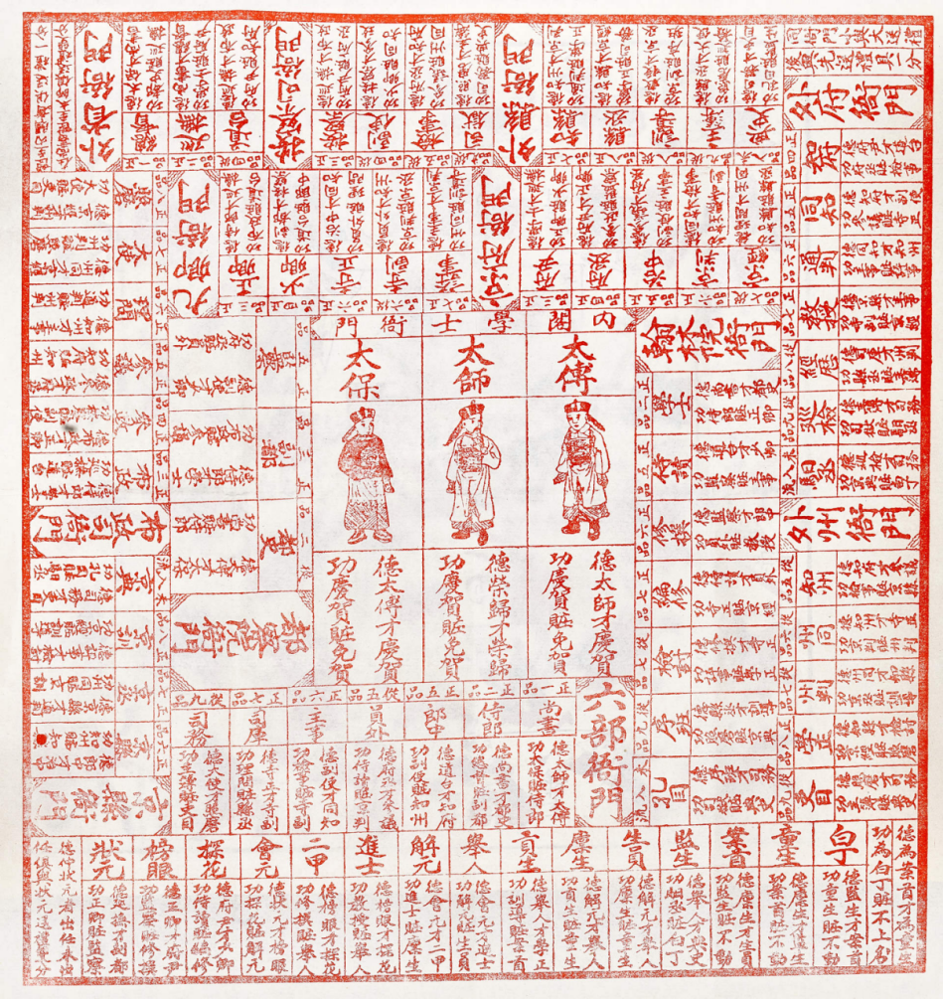
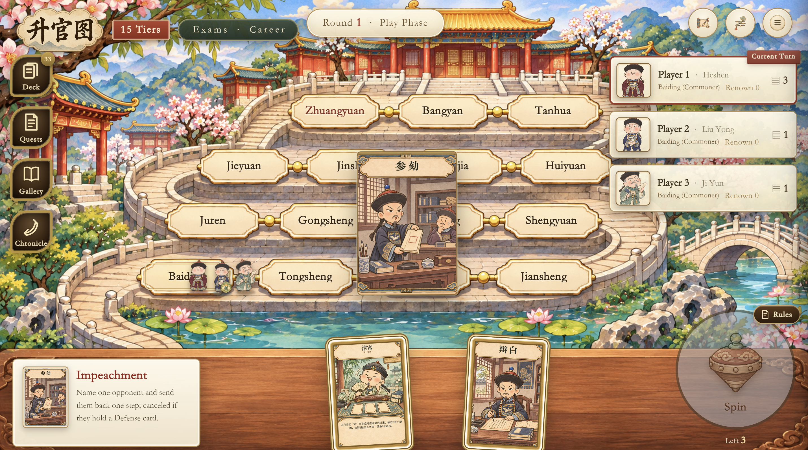
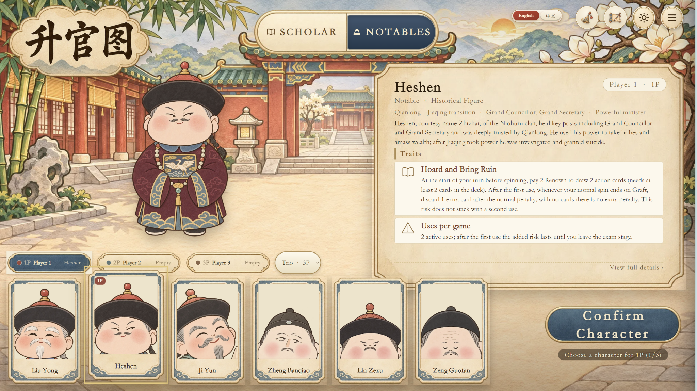
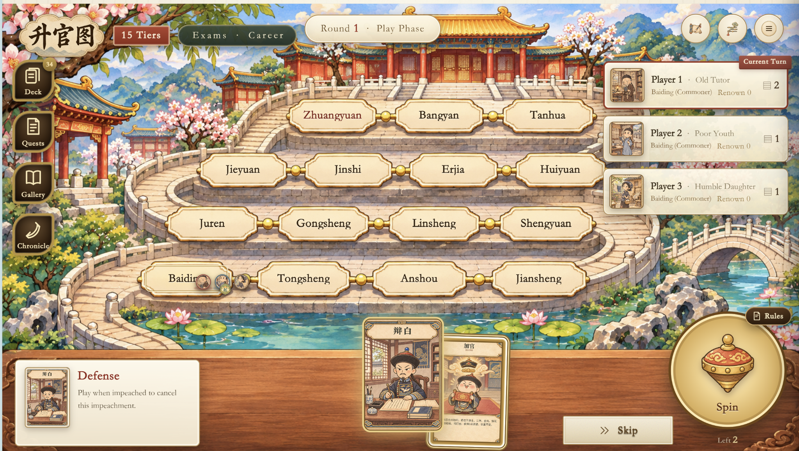
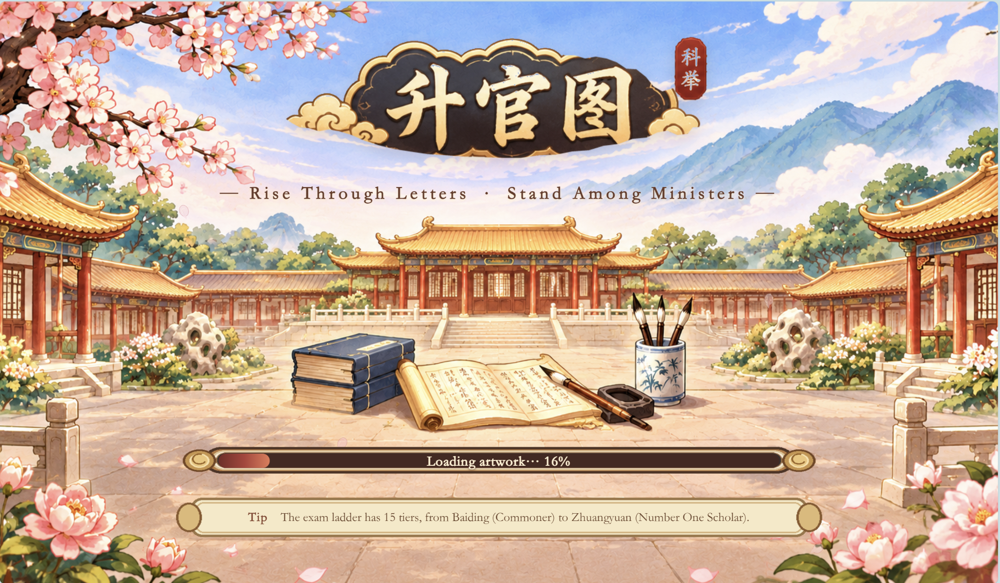
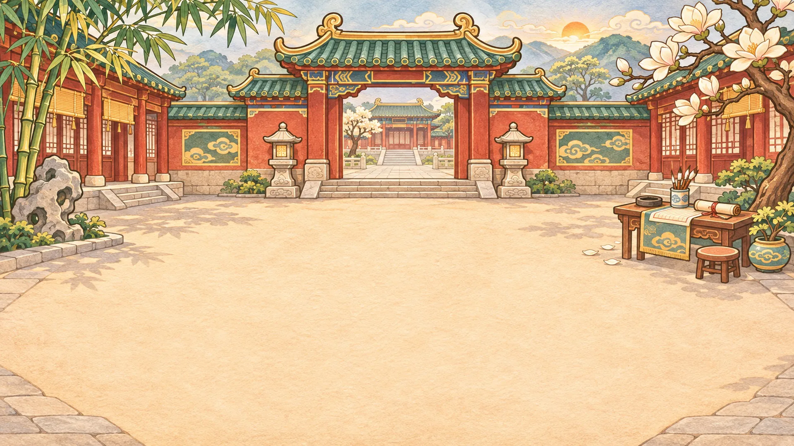
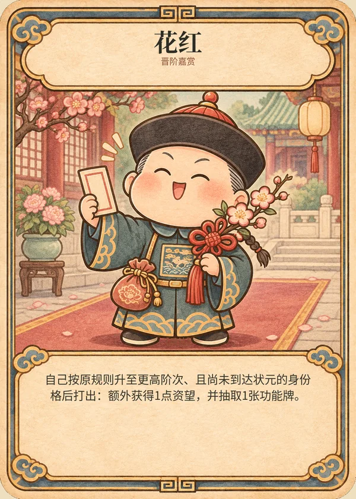

# Shengguan Tu · Records of Eminent Officials

*Historical play, reinterpreted through a digital medium.*

[Play in browser](https://luoluo926.github.io/sheng-guan-tu/) · [Mirror](https://37k7pztvvw9neu47eoq.traesite.cn/) · [Repository](https://github.com/luoluo926/sheng-guan-tu) · [Contact](mailto:3240100942@zju.edu.cn)

**Shengguan Tu · Records of Eminent Officials** develops from *Shengguan Tu: Imperial Examination Edition* (升官图·科举版). Through illustrated environments, character identities, action cards, and the four-sided judgment top, it brings a traditional Chinese culture of examination and official advancement into the space of digital art.



*The Guangxu-period folding Shengguan Tu held by the Palace Museum (inventory 故179983), the historical object this edition works from.*

## Screenshots

<div align="center">
  
  
</div>
<div align="center">
  
  
</div>

*The examination ladder in play, character selection in Notables mode, the same board in Scholar mode, and the loading screen.*

## A miniature world of officialdom

Historical *Shengguan Tu* boards translated ranks, institutions, and judgments into a sequence of movements. Their appeal lay partly in an unlikely encounter: a bureaucratic order, with its graded offices and moral expectations, rendered as an object of recreation. Every position had a name. Every change of status invited an interpretation of conduct, accomplishment, or fortune.

An important point of reference is the Guangxu-period folding *Shengguan Tu* preserved by the Palace Museum (inventory **故179983**). Its three circuits arrange examination status and offices within an elaborate hierarchy. A four-sided top inscribed **德** (virtue), **才** (ability), **功** (merit), and **赃** (corruption) determines the category of judgment. The object makes visible an historical imagination of rank and advancement, shaped by institutional language and the contingency of play.

Examination achievement and appointment to government office occupied distinct places in imperial China's political order. A game board condenses those relationships into its own coherent logic. The relationship between historical institutions and their playful representation reveals how official culture entered ordinary cultural life.

**Historical object:** [Palace Museum, Folding *Shengguan Tu*, inventory 故179983](https://www.dpm.org.cn/collection/utensil/232141.html).

## Digital humanities as interpretive practice

A historical game carries information in its words and pictures, and also in the structure of its rules. The possible moves, judgments, restrictions, and interruptions express ideas about how a social order might work. Translating such procedures into executable code therefore involves historical interpretation.

This edition transforms named positions into places to visit, evaluative terms into consequences, and chance into a visible interaction. Players encounter explanations of identity and judgment as the game unfolds. They can also review rules and the record of a session. In this way, the interface places an historical source in conversation with a player's own sequence of choices.

The project takes **Shengguan Tu: Imperial Examination Edition (升官图·科举版)** as its immediate development base and builds on its fifteen-stage examination route. New character identities, strategic cards, multiplayer encounters, and illustrated endings extend the edition into a richer shared experience. Historical references, inherited rules, and newly designed mechanics remain identifiable throughout the project documentation.

This creative process sits between historical game studies, interactive heritage, and digital art. It treats a game as an object that can be studied through participation and brings the interpretation of its rules into public view.

## Visual research and artistic production

The visual direction draws on the Palace Museum artifact, late-Qing *Dianshizhai Pictorial*, historical imagery relating to the Jiangnan Examination Hall, and Qing civil-official rank badges. Their motifs inform architecture, clothing, borders, and card illustration. They serve as points of visual research; the finished screens are contemporary digital compositions.

Visual materials were produced with generative-AI assistance, followed by human selection, revision, and integration. Claude, Trae, and OpenAI Codex supported programming and iterative development. Historical selection, game direction, final editorial choices, and responsibility for publication remain with the creators.

<div align="center">
  
  
</div>

*Selected visual assets from the project. A separate media package contains development screenshots and a short interface preview.*

## Playing the game

Players begin at **白丁** and take turns using cards and a spinning top. The outcomes **德 / 才 / 功 / 赃** interact with a player's current position and any applicable card or character effects. The game provides in-context explanations and a session record. It supports separate Chinese and English interfaces.

**Play:** [Open the browser game](https://luoluo926.github.io/sheng-guan-tu/) · **Mirror:** [traesite.cn](https://37k7pztvvw9neu47eoq.traesite.cn/) · **Code:** [GitHub repository](https://github.com/luoluo926/sheng-guan-tu).

A desktop browser is recommended. The in-game handbook explains turn order, examinations, card effects, outcomes, and victory conditions.

## Artists, researchers, and contributors

**Creators:** 陈骆彦 (Chen Luoyan), 陈珂涵 (Chen Kehan), 张燕飞 (Zhang Yanfei), 周佳 (Zhou Jia)  
**Team:** 浙江大学数智史学实验室团队 (Zhejiang University Digital History Laboratory Team)

The creative process draws on historical resources from the Zhejiang University Digital History Laboratory team and on publicly accessible museum and archival collections.

## Music, sound, and permissions

- **Music:** *Vermilion Corridor* (C140B) and *Lantern Alley* (C175A), from BOOTH releases.
- **Sound effects:** `free_sample_pack` and `marutto_free_sample_v3`.
- **Attribution and source records:** [`assets/audio/CREDITS.md`](assets/audio/CREDITS.md) and the included license summaries.

The original licensing records are preserved in the audio directory. Licensing and source information accompany the public release materials.

## Code and access

Vanilla HTML, CSS, and JavaScript. The project is a static browser application with content in `data/` and image, sound, and interface assets in `assets/`. No build system is required.

```bash
python -m http.server 8000
# Open http://localhost:8000/
```

The site is published straight from the `release` branch, with no build step, so what is committed is what ships. The browser game is also available at the live link above.

**Email:** [3240100942@zju.edu.cn](mailto:3240100942@zju.edu.cn) · **Issues:** [Report a problem](https://github.com/luoluo926/sheng-guan-tu/issues)

---

# 升官图 · 名臣录

*传统游艺的数字人文转译*

[在线试玩](https://luoluo926.github.io/sheng-guan-tu/) · [镜像](https://37k7pztvvw9neu47eoq.traesite.cn/) · [源码](https://github.com/luoluo926/sheng-guan-tu) · [联系](mailto:3240100942@zju.edu.cn)

## 方寸官场

科举与入仕牵系着古代读书人的前途、家族的声望和个人的身份。科名、品秩、官缺、铨选各有制度脉络，也构成了传统社会理解荣辱升沉的重要语汇。升官图将这些名目编排在可供行棋的图盘中，使繁密的官制进入日常游艺。

本作的重要参照是故宫博物院藏清光绪折叠式升官图，文物编号 **故179983**。原物以三圈排列功名出身与官职等级，以刻有 **德、才、功、赃** 的四面陀螺决定判定类别。陀螺引入偶然，棋盘规定路径，德行与功业的评价在升降之间获得具体形态。图盘保留着有关秩序、身份和仕途无常的历史想象。

科举取士与铨选授官虽有联系，仍属不同制度环节。传统游艺对官制的概括自有其规则和尺度。游戏因此也成为理解古人如何认识制度、组织等级与寄托世情的一份文化材料。

## 以交互阅读历史

传统游戏的史料价值存在于文字、图像与判语之中，也存在于规则的组织方式。哪些身份可以抵达，什么行为受到褒贬，等级如何流动，偶然性在何处介入，均是可以讨论的历史问题。

在升官图 · 名臣录中，身份名目转化为可到达的格位，陀螺判定形成可见的升降，人物与卡牌引入现代桌游的选择机制。身份释义、规则细则和对局纪事将游戏行为与相关知识相连接。玩家沿着一次次判断和行进接触历史制度的语汇，也能辨认作品对原有规则作出的取舍。

本作以《升官图·科举版》为直接开发底版，沿用其以科举身份为脉络的十五阶路线，并在此基础上发展人物选择、多人互动、行动卡牌和结局呈现。清代升官图的官制、判语与图像构成历史参照；科举版提供可操作的玩法结构；名臣录的创作则进一步组织历史叙事、艺术图像与互动体验。玩家在升降往复之间辨认传统制度的名目，也感受游戏如何记录人们对功名和际遇的想象。

## 图像与创作

作品的视觉参照包括故宫馆藏升官图、晚清点石斋画报、江南贡院历史影像及清代文官补子。建筑、服饰、纹样与卡面经过重新组织，形成连续的数字场景。历史材料承担考据与启发的作用；游戏画面属于当代数字艺术表达。

美术素材由生成式人工智能辅助创作，创作团队负责选择、修订和整合。Claude、Trae、OpenAI Codex 参与编程与开发迭代，历史材料的取舍、玩法与视觉方向由团队确定。

## 界面一览

<div align="center">
  
  
</div>
<div align="center">
  
  
</div>

*依次为科举阶梯对局、名臣模式选角、书生模式对局与加载界面。*

## 作品与团队

浏览器内即可游玩，无需安装。作品支持中文与英文界面，建议在桌面浏览器体验。

**作者：** 陈骆彦、陈珂涵、张燕飞、周佳  
**团队：** 浙江大学数智史学实验室团队  
**邮箱：** [3240100942@zju.edu.cn](mailto:3240100942@zju.edu.cn)

史料来源与音频鸣谢详见英文部分及仓库 [`assets/audio/CREDITS.md`](assets/audio/CREDITS.md)。
